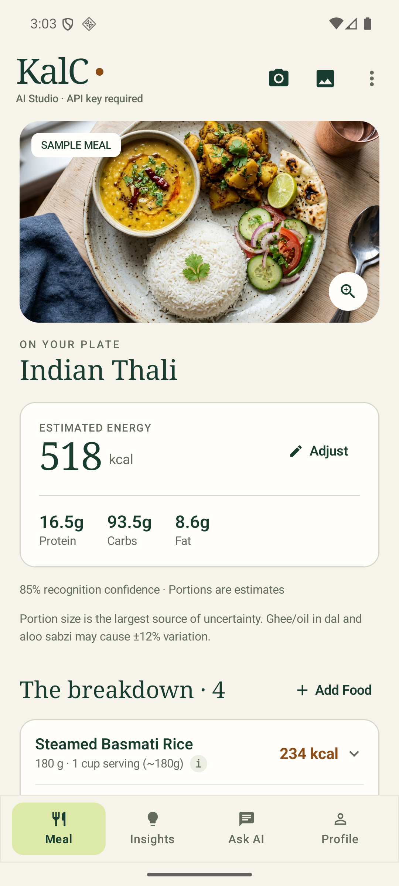
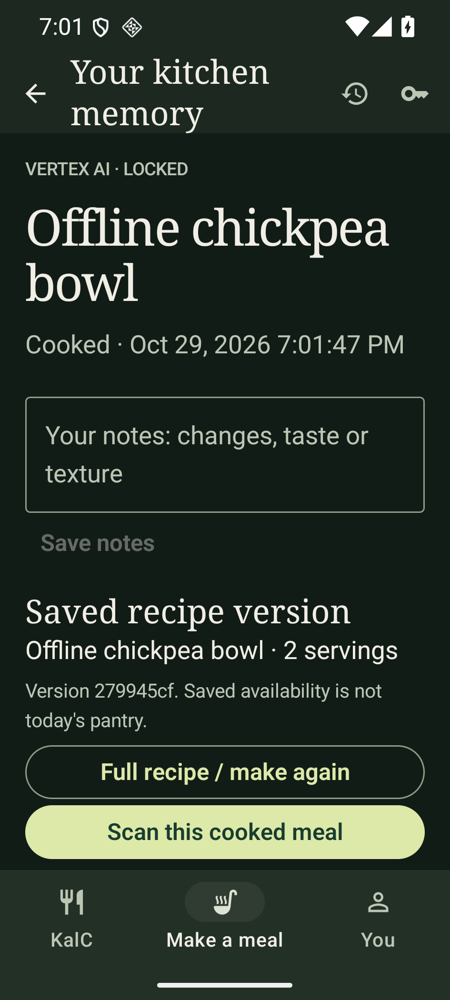

<p align="center">
  
</p>

<h1 align="center">KalC</h1>
<p align="center"><strong>Understand your plate. Cook with what you have.</strong></p>
<p align="center">Native Android · Kotlin & Jetpack Compose · Gemini 3.8 Flash</p>

KalC combines photo-based meal estimates with a personal cookbook. Scan a meal for calories and macros, turn available ingredients into recipes, and keep your scans and cooking history on your device.

**Current version: 1.4.2** · Android 7.0+ · [Latest release notes](docs/COOKBOOK_1_4_2.md)

[Install](#install-on-your-phone) · [Features](#explore-the-app) · [AI setup](#choose-your-ai-connection) · [Build](#build-and-run) · [Verification](#quality-and-verification) · [Documentation](#documentation)

## A look inside

<p align="center">
  
  
  
</p>

Meal analysis, the refined cookbook, and local history. Screenshots come from different releases; the cookbook uses a synthetic test recipe.

## Install on your phone

1. Copy or download the signed **`KalC-v1.4.2.apk`** to your phone.
2. Open it from **Files** or **Downloads**.
3. If Android asks, enable **Allow from this source** for the app opening the APK.
4. Tap **Install** or **Update**.

No USB cable, developer options, or USB debugging is required. This is a directly installed APK, not a Play Store listing. The APK is not bundled in this repository; the owner build is available in the owner's Downloads folder.

Updates signed with the same owner certificate preserve existing app data. An older debug build has a different certificate and must be uninstalled first, which removes its saved data.

## Explore the app

| Section | What you can do |
| --- | --- |
| **KalC** | Scan camera/gallery photos, review food and portion estimates, adjust weights, add side dishes, and ask questions about the meal. |
| **Make a meal** | Photograph ingredients or enter them manually, confirm your pantry, and choose servings, time, cooking style, staples, equipment and food avoidances. |
| **Cookbook** | Read ingredient quantities, timings, numbered instructions and cook's notes. Confirm preparation requirements, follow cooking steps, use timers, and ask recipe-specific questions. |
| **History** | Revisit successful scans, saved recipes and confirmed cooked meals. Reopen saved information offline and optionally scan a finished plate for nutrition estimates and cooking feedback. |
| **You** | Complete or skip onboarding, edit your profile and goals, and choose whether to personalize AI answers. |

### From ingredients to dinner

1. **Add ingredients** with photos or manual entry, then review quantities and raw/cooked state.
2. **Set the brief** with your preferred cuisine, time, portions and available extras.
3. **Explore three recipe groups:** cook now, recipes needing a few extras, and more ambitious recipes requiring more ingredients or effort. Quick Grab highlights a fast option; Healthy Grab can use explicitly enabled profile context.
4. **Open the cookbook** and confirm the required ingredients and equipment through **Prepare to cook**.
5. **Begin cooking**, follow the method, then confirm the meal as cooked to save it. Optionally scan the finished plate for KalC analysis and a review.

Cooking starts only after required preparation checks and food restrictions are satisfied. Unknown ingredient amounts do not establish that a recipe is ready to cook.

### Personalization and local history

- **Personalize answers defaults off.** Onboarding is skippable. Users can edit height, weight, age, activity, goals, food preferences, allergies and optional health notes.
- Profile details are encrypted on the device and excluded from backups. When enabled, relevant context goes to the selected AI provider for applicable advice/chat; the name stays local and photo recognition does not use the profile.
- The kitchen asks separately before using profile context for a cooking session.
- Local history is enabled by default and stores successful scans, cooked-meal records, saved recipe snapshots and associated photos in app-private storage. Opening saved history does not call AI.

See [profile privacy](docs/PROFILE_RELEASE_1_3.md) and [kitchen data boundaries](docs/MAKE_A_MEAL_RELEASE_1_4.md) for details.

## Choose your AI connection

Open **API Key & AI Settings** and choose a provider:

| Option | What you need | How access works |
| --- | --- | --- |
| **Vertex AI server** | The server's shared passkey | Uses the On Sundays Google Cloud backend. An incorrect passkey grants no server access. |
| **Google AI Studio** | Your own Google API key | Requests go directly to Google using your key. No server passkey is needed. |

Both paths use **`gemini-3.8-flash`** with LOW thinking and no fallback to a different model. Google usage charges and quotas apply to the selected provider.

Vertex sessions last up to 12 hours and remain in memory. Restarting the app process, changing providers, disconnecting, expiry or a rejected session locks access. Switching providers retains the saved Studio key. The app never persists the raw server passkey, and the backend never receives Studio keys.

For deployment, credential rotation and private signing, see the [server guide](server/README.md).

## How meal analysis works

**Photo → food validation → item and portion estimates → local nutrition calculations → optional insights/chat**

On-device image checks and structured AI validation reject non-food, empty, ambiguous and insufficient-confidence detections before accepting a meal. Users can correct estimated portions afterward.

Nutrition arithmetic uses grams and per-100g references. Known foods resolve against the local nutrition catalogue; unmatched foods may use model-supplied reference values. Deterministic arithmetic does not make visual portions or reference values exact. New recognition and AI recipe generation require a working connection; saved records remain available offline.

Recipe nutrition is withheld when ingredient coverage or usable weights are incomplete. Scanning the actual finished plate provides a separate estimate. Photos cannot establish taste, internal temperature or safe doneness, and generated recipes have not been kitchen-tested.

## Build and run

### Requirements

- Android Studio with JDK 17 or newer compatible with the project's Android Gradle Plugin.
- Android SDK 36.1; an emulator or device running Android 7.0 / API 24 or newer.
- Internet access for dependency downloads and live AI features.
- Node.js 22+ only if running the optional Vertex backend locally.

### Quick start

```powershell
git clone https://github.com/sobiswriter/NewKalC.git
cd NewKalC
./gradlew.bat :app:assembleDebug
```

Open the project in Android Studio, sync Gradle, and run the `app` configuration. The debug APK is written to `app/build/outputs/apk/debug/app-debug.apk`. On macOS/Linux, use `./gradlew` instead of `./gradlew.bat`.

Configure a provider in the app. The public Vertex URL defaults to the value in `.env.example`; an ignored `.env` can override it with `VERTEX_SERVER_URL`. Keep the server passkey and signing credentials outside the repository. Do not embed a private Studio key in a distributed APK.

### Common commands

| Command | Purpose |
| --- | --- |
| `./gradlew.bat :app:assembleDebug` | Build a development APK. |
| `./gradlew.bat :app:testDebugUnitTest` | Run unit and Robolectric tests. |
| `./gradlew.bat :app:lintRelease` | Run release lint checks. |
| `./gradlew.bat :app:connectedDebugAndroidTest` | Run instrumentation tests on a connected emulator/device. Live provider tests require runtime credentials. |
| `./gradlew.bat :app:assembleRelease` | Build the signed release after configuring private signing credentials. |
| `node --test server/server.test.mjs` | Run backend tests from the repository root. |

Release output: `app/build/outputs/apk/release/app-release.apk`. See [signing instructions](server/README.md#signed-apk-installation) before building a distributable update. Preserve the owner certificate so future APKs can update existing installations.

### Project map

```text
app/src/main/java/com/example/
├── data/auth/       AI provider settings and Vertex sessions
├── data/gemini/     Meal analysis, insights and chat
├── data/kitchen/    Recipe AI and private local history
├── data/model/      Meal and kitchen models
├── data/nutrition/  Local nutrition references
├── data/profile/    Encrypted profile and consent
└── ui/              Compose screens, state and cooking flow
app/src/test/        Unit and Robolectric tests
app/src/androidTest/ Native UI and integration tests
server/              Passkey-protected Vertex proxy and deployment scripts
docs/                Release notes, verification, screenshots and storyboard
```

## Quality and verification

Version **1.4.2** refines cookbook typography, ingredient rows, numbered steps and the preparation action. It also fixes conversation space on short landscape screens. Version **1.4.1** corrected stretched illustrations and replaced the blocked cooking entry with a preparation checklist.

Latest recorded checks:

- **35 unit/Robolectric tests passed** and release lint completed with **zero errors** (76 warnings remain).
- **20 distinct layout/flow combinations passed across successful runs**, covering widths from 320–480dp, an 800 × 360dp landscape layout, light/dark themes and text scaling up to 150%.
- Native checks exercised image viewing, manual ingredient entry, preparation from an empty pantry, starting and completing cooking, and reopening saved history.

These checks used an API 36 emulator. Physical **Realme 8 5G / Android 13**, real camera/gallery provider behavior and TalkBack remain unverified. Representative layouts do not certify every phone, font setting or recipe. Earlier live Vertex checks are documented separately; a live Studio request with an owner's key was not verified.

[Full screen matrix and screenshots](docs/COOKBOOK_1_4_2.md) · [Kitchen verification](docs/MAKE_A_MEAL_RELEASE_1_4.md) · [Provider verification and measured timings](docs/MIGRATION_VERIFICATION.md)

## Documentation

| Guide | Contents |
| --- | --- |
| [Cookbook & responsive layouts — 1.4.2](docs/COOKBOOK_1_4_2.md) | Latest design changes, screen matrix and verification limits. |
| [Cooking & image fixes — 1.4.1](docs/QA_1_4_1.md) | Preparation flow, aspect-ratio fixes and regression checks. |
| [Make a meal & history — 1.4](docs/MAKE_A_MEAL_RELEASE_1_4.md) | Kitchen features, persistence, privacy, timers and release verification. |
| [Profile & onboarding — 1.3](docs/PROFILE_RELEASE_1_3.md) | Profile fields, optional personalization and privacy. |
| [Native visual refresh — 1.2](docs/VISUAL_RELEASE_1_2.md) | Earlier native design release and screenshots. |
| [Vertex server](server/README.md) | Backend setup, authentication, deployment, limits and release signing. |
| [Migration verification](docs/MIGRATION_VERIFICATION.md) | Provider checks and observed timings. |
| [Product storyboard](docs/make-a-meal/PRODUCT_STORYBOARD.md) | Original approved kitchen concept and design reference. |

The HTML storyboard is a design reference; the shipped application is native Android. Food and nutrition results are estimates, not clinical dietary advice.
