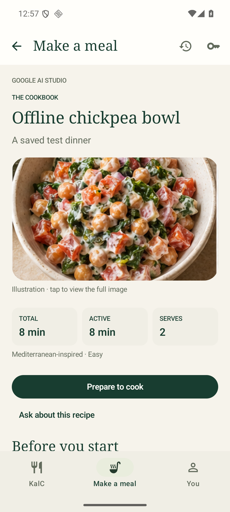
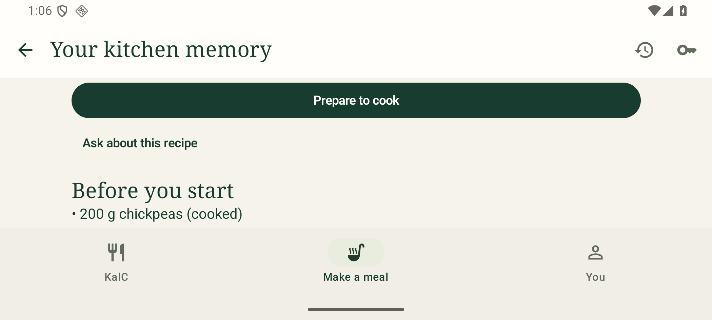

# KalC 1.4.2 — cookbook and responsive layouts

The recipe page uses a serif book-style heading, an aspect-preserving food illustration, a compact total/active/servings summary, separated ingredient rows, numbered method cards and cook's notes. Prepare to cook is near the top; it opens the explicit ingredient/equipment checklist. Begin cooking remains blocked until required ingredients and equipment are confirmed and food restrictions are satisfied.

Kitchen content is centered and capped at 680dp on wide layouts. Small phone layouts scroll without imposing fixed content heights. Short-screen meal chat removes optional prompt chips/context text and dismisses the keyboard after sending, leaving space for conversation.

Native testing covers representative phone widths, portrait/landscape, large text and dark mode. Fixtures are synthetic. Off-screen lazy-list controls are reached through scrolling rather than assuming every item is composed simultaneously. The saved-recipe test starts with an empty pantry, confirms the required food, begins and finishes cooking, then reopens history.

Physical Realme 8 5G / Android 13 camera, gallery provider and TalkBack behavior have not been hands-on verified. Representative layout tests do not certify every possible phone or font setting.

## Results — 30 October 2026

| Phone layout | Font | Appearance | Kitchen flows |
|---|---|---|---|
| 320 × 640dp | 100% | Light | 2 passed |
| 360 × 800dp | 130% | Dark | 2 passed |
| 393 × 873dp (rounded) | 100% | Light | 2 passed |
| 432 × 960dp | 100% | Dark | 2 passed |
| 480 × 960dp | 150% | Light | 2 passed |
| 800 × 360dp landscape | 100% | Light | 2 passed |

Four additional meal/profile flows passed at each extreme (320dp and landscape): **20 distinct layout/flow combinations passed across successful runs**. Initial short-viewport test failures were corrected to scroll lazy lists before accessing controls; no tests were skipped. Landscape testing also found and fixed the meal-chat keyboard/space problem.

**35 unit tests and full release lint passed**; lint reports zero errors. Native checks include viewing an illustration, manual entry, opening a saved recipe with an empty pantry, confirming ingredients, Begin cooking, completing the meal and reopening saved history. These are representative layouts on an API 36 emulator, not hands-on Android 13 handset certification.

Version 1.4.2 (code 7), normal non-debug APK, same owner signing certificate. Downloads/KalC-v1.4.2.apk updates the existing signed app without uninstalling. SHA-256: `a21d9d9bc89f63262aeca7dd0db0a4f942e2788e593642521bd5597024a8b731`.

