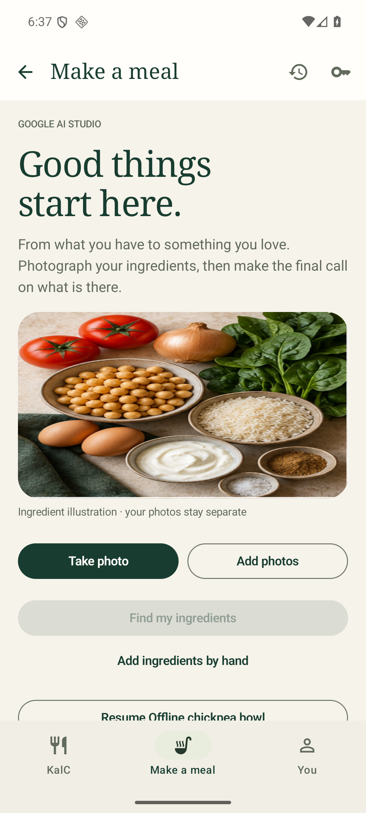
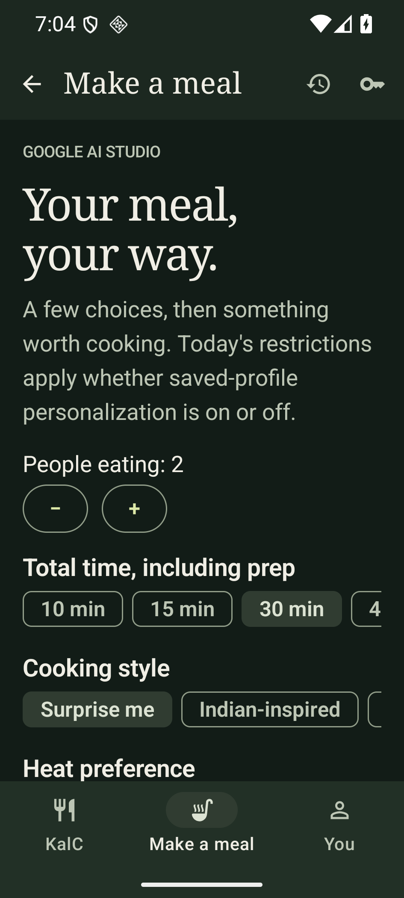
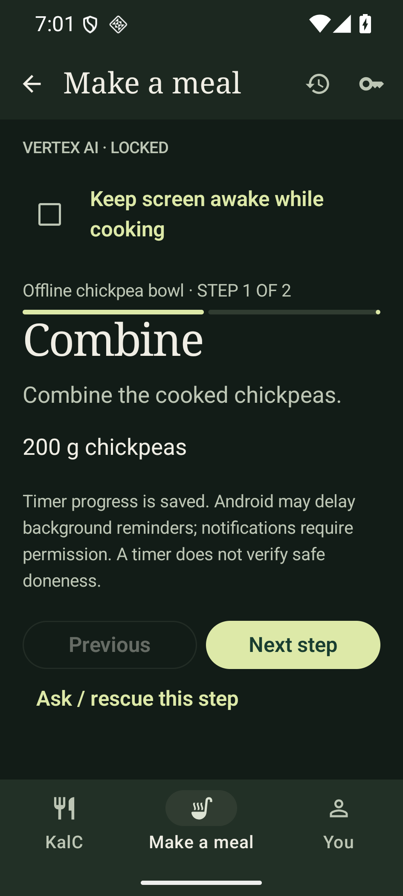
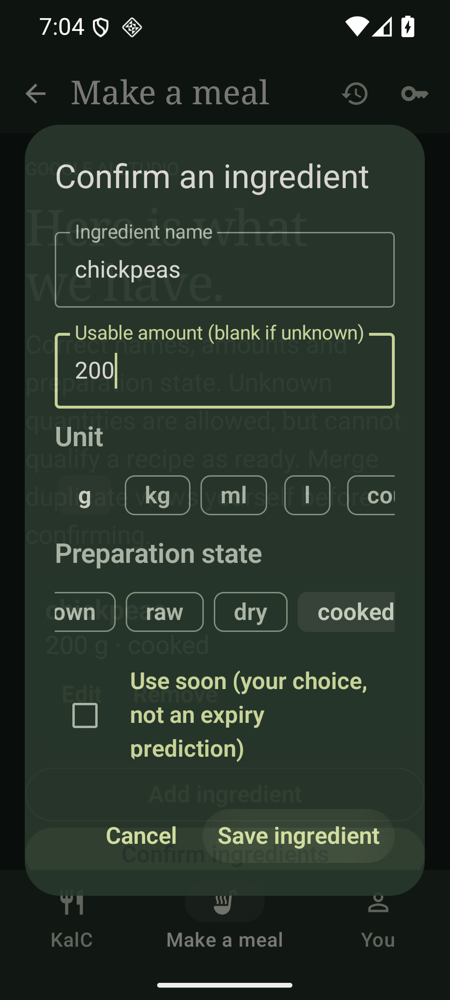
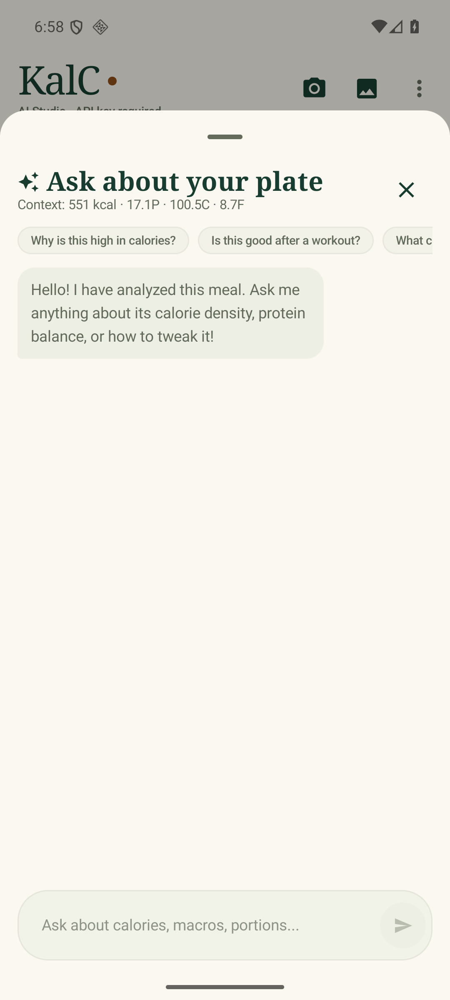

# KalC 1.4 — Make a meal and local kitchen history

Implementation of the approved [storyboard](make-a-meal/PRODUCT_STORYBOARD.md). The HTML storyboard remains a fictional design example; the feature now lives in the native Android application.

## What users can do

- Navigate between KalC, Make a meal and You. Insights/chat remain contextual in KalC. History is reachable from KalC, the kitchen header and You.
- Capture an ingredient photo, choose up to three gallery images, or enter ingredients manually. Review names, quantities, units, cooked/raw/dry state and user-marked use-soon ingredients. Unknown amounts cannot establish a ready recipe. Duplicate detections are not summed automatically.
- Explicitly confirm staples and equipment. Choose portions, total time, global cooking style, heat and food avoidances. No oil/spices/hob are assumed by the new flow.
- Generate varied recipe summaries in compact batches, then see deterministic Cook now / A few extras / Worth the effort groups. Quick Grab chooses the fastest ready everyday option. Healthy Grab chooses a ready option with a variety of plant ingredients, within the authorized suggestion set; it is not a clinical score or lowest-calorie promise.
- Load a complete cookbook only after choosing a recipe. See ingredients, exact shortages, full method, equipment and time estimates; save the complete recipe offline. Owned concept imagery is explicitly illustrative rather than a claimed photograph of a generated dish.
- Follow steps with scaled ingredient amounts, saved progress, an optional keep-awake setting and a persisted timer deadline. Background notifications require permission. Android's inexact alarm can be delayed; the app shows the saved deadline independently. Restarting the app recovers the cooking session. Force-stop/reboot can prevent background reminders; do not use the timer to certify safe cooking.
- Ask recipe-specific cooking/rescue questions. A substitution is a proposal until a complete revised recipe is reviewed and accepted; accepted versions recheck missing items and restrictions. Previous saved recipe versions remain intact.
- Confirm cooked explicitly. With automatic history enabled, this saves the cooked session and its complete recipe before any optional AI request. Skip the plate photo or take/choose one for KalC analysis, then explicitly request a saved cooking review. Cooking does not imply eating or contribute to a daily intake counter.

## History, storage and privacy

Successful real KalC analyses automatically save their item breakdown, original analysis, adjustments, confidence/uncertainty, insights and a bounded app-private photo. Preset samples are excluded from automatic history. Old scans performed before 1.4 cannot be reconstructed.

The shared indexed SQLite library offers All / Scanned / Cooked / Recipes, paged results and complete offline snapshots. A plate scan links to its cooked meal; the All view folds linked scans under that meal, while Scanned still exposes the source scan. Planned recipe estimates and actual-plate estimates are distinct and never added together as consumption.

History is enabled by default and disclosed in its screen. Turning it off stops new automatic library entries, retains existing ones, and permits explicit Save. Current cooking progress is stored separately so interruption recovery does not depend on library saving. Controls remove a photo while keeping text, delete an entry, or clear the library. Deleting a cooked record detaches its scans rather than deleting independently saved scan/recipe information.

Database, recipe snapshots, photos and cooking progress live under Android `noBackupFilesDir`, excluded from automatic backup/device transfer. They persist through ordinary restarts and signed updates but can be lost on uninstall, clear-data, device loss or storage damage. No cloud history service was added. This follows Android's [backup exclusions](https://developer.android.com/identity/data/autobackup).

Saved history never enables personalization or sends the full timeline to AI. Ingredient recognition has no profile parameter. Cooking recommendations/chat/revisions require both the existing master profile consent and a separate session choice. Only relevant goals, preferences, age and health notes are included; name/height/weight stay out of cooking requests. Explicit session avoidances apply independently. Profile/provider changes cancel pending kitchen work, discard personalized suggestions/chat and reset session consent; already-sent requests cannot be recalled. Existing profile encryption remains unchanged.

## AI, safety and performance

All new operations reuse the current selected provider and authentication, Gemini 3.8 Flash and LOW thinking. The backend contract/caps are unchanged; there is no deployment or silent provider/model fallback. Recognition keeps the local image gate and requires valid model food flags/confidence. Rejected, unclear, cancelled or failed scans are not saved as successful meals.

The new structured responses have bounded fields, valid units/states, positive finite quantities, method ingredient references and output-completion checks. Incomplete responses prompt a retry rather than displaying half a recipe. Availability, shortages, scaling and shortcut choices run locally. No AI request is made for each checkbox, to browse history, or to reopen saved recipes. Selected cookbook details are cached for the current session and saved recipes reopen offline.

The optional cooking review uses only the selected recipe, analyzed plate cues and user report. It separates observations, uncertainty and next-time suggestions. Photos cannot establish taste, internal temperature or safe doneness. AI recipes and time estimates can be wrong and have not been kitchen-tested.

Recipe nutrition uses exact local-reference matches and usable gram amounts. When catalogue coverage/weights are incomplete, the app explicitly withholds a complete estimate and offers the actual-plate KalC scan. It does not use a generic dish fallback or invented AI totals to fill missing ingredient data. Optional garnishes are excluded from planned totals. Saved recipe methods retain their original serving basis; scaled quantities are shown separately, with a warning that pan size/timing may need adjustment.

## Verification and installation

Verified on 29 October 2026:

- **34 Android unit/Robolectric tests passed.** Coverage includes quantity/state/unit/equipment matching, avoidance synonyms, no false Quick Grab, complete methods, history snapshots and original/calculated totals, linked-record deletion, photo removal without losing information, bounded image decoding, session restrictions/deadlines, profile-purpose consent, structured response completion, and existing provider/profile/non-food regression tests.
- **10 backend tests passed.** Anonymous/wrong/expired/rotated access, payload restrictions, output budgets, secret isolation and throttling remain unchanged.
- **Six core native UI tests passed across the successful runs:** two new kitchen flows, the meal/editing/insights/chat/provider-settings flow, and three existing profile flows. Manual ingredient entry and the saved cookbook → cook → confirm → activity restart → offline history journey work without AI. The same six paths were checked at **360dp, 130% text and dark mode**; the manual-entry harness explicitly closes the keyboard before interacting with the dialog controls.
- **Two new live Vertex integration tests passed** with owner credentials supplied only at runtime and synthetic inputs: ingredient recognition → six-recipe discovery → validated full cookbook → cooking chat → bounded review; and actual plate analysis → automatic private photo/result save linked to a synthetic cooked recipe. These verify the contracts and persistence, not recipe quality or actual cooking. The initial post-boot network failure and nullable-unit response were investigated; unknown amounts remain unknown and the successful rerun passed.
- **A real scheduled timer delivered its notification on the emulator**, with notification permission granted for this test. The reminder was cancelled/cleared afterward. Denied permission remains an explicit UI state, not a promised notification.
- **Full release lint passed with zero errors (76 warnings)** after a successful serial analysis. An earlier tooling crash was retried; the resulting three existing resource errors were fixed with API-qualified navigation-bar themes and a proper launcher-background drawable. No checks were suppressed. Existing style/deprecation warnings remain, including the platform EXIF reader.
- Both AI providers retain their existing configuration and selection rules. Studio transport/model/consent are checked with intercepted requests; no owner's valid Studio key was provided for a live Studio request.

The signed package is **version 1.4, version code 5**, application ID `com.aistudio.foodcalorie.qx7v`, min SDK 24. APK inspection confirms it is neither debuggable nor test-only. Certificate SHA-256 remains `8cc8a357ddfe4a6e0f596b020bdf0b118e7dd4d6032997bb181f15fff90a3e14`, matching prior owner releases. The emulator accepted the 1.3 → owner-signed 1.4 verification update without uninstalling; the exact final non-debug release is also installed and cold-started separately.

Final APK SHA-256: `a0387d6f52111bdc505b6ad7fd0ad23685acf1aa170800b23680db88108eb0d0`.

Cold-start checking exposed eager reflective serializer construction. History adapters now initialize on their background read/write path; kitchen AI setup and structured-response parsing run on IO workers. On this emulator, a warm-cache cold activity launch improved from **1,660 ms before that change to 866 ms afterward** (the first earlier post-install launch was 2,040 ms). These are observed development measurements, not controlled physical-device benchmarks or Google response-time guarantees. Recipe/ingredient matching and history browsing do not wait for AI.

Owner artifact: **Windows Downloads/KalC-v1.4.apk**, with a backup at `%LOCALAPPDATA%/KalC/artifacts/KalC-v1.4.apk`. Open the transferred/downloaded APK on the phone, allow installation from that source if Android asks, and tap Update/Install. USB debugging is not required. Keep the existing release installed to retain its data; earlier differently signed debug builds require separate handling.

All screenshots below contain synthetic test data. Physical-device camera, TalkBack, vendor-specific rendering and recipe execution need separate real-world checks; emulator evidence does not establish those. Background alarm delivery can be delayed by Android and is not a food-safety guarantee.

| Kitchen entry | Cooked-meal history, 360dp / 130% text / dark |
|---|---|
|  |  |

| Meal brief, dark | Cooking mode, dark |
|---|---|
|  |  |

| Ingredient confirmation, dark | Existing meal chat remains available |
|---|---|
|  |  |
