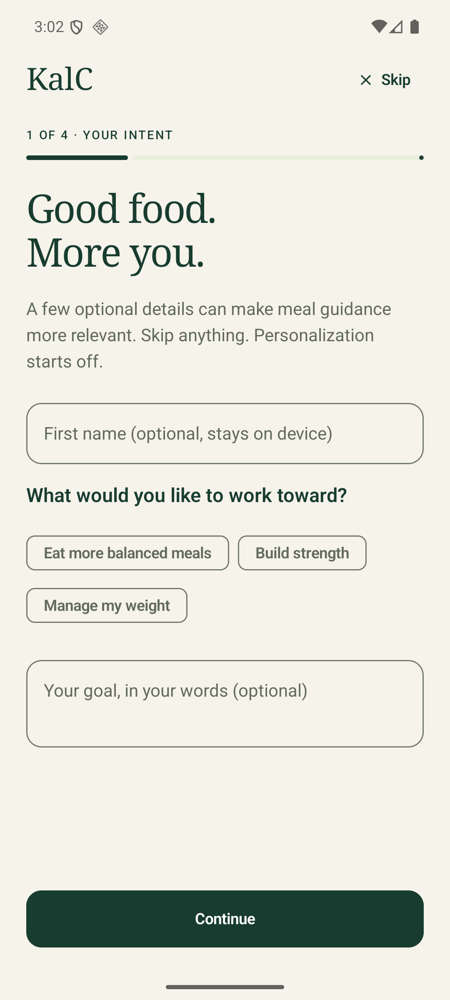
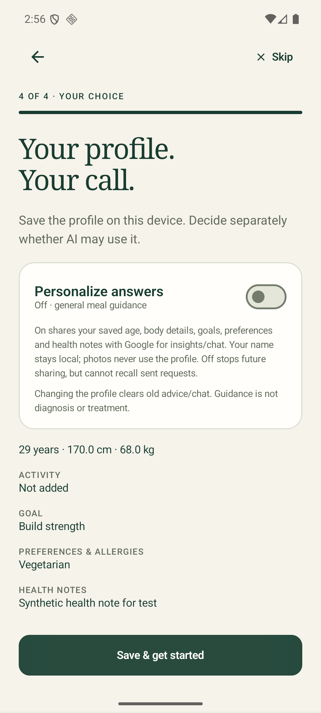
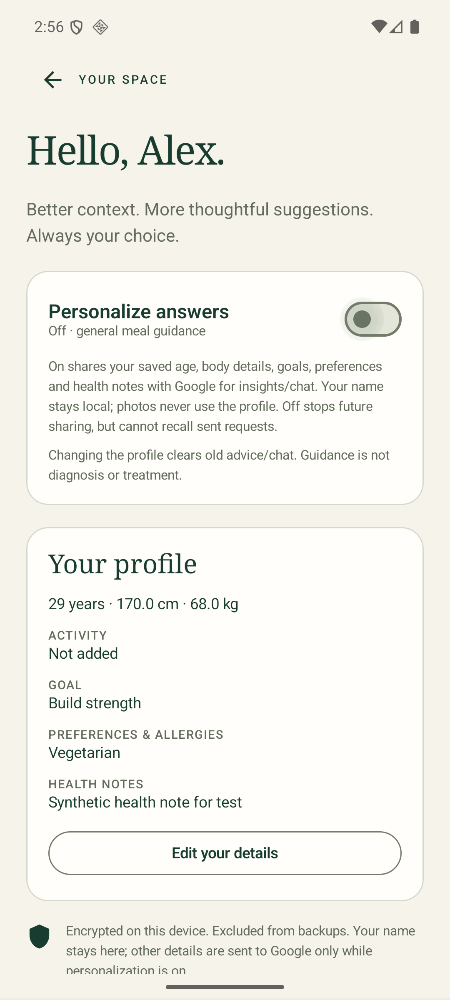

# Version 1.3 — premium meal view and optional personalization

- Remove the duplicated bottom scan/gallery strip; retain the top camera/gallery actions.
- Simplify the meal title, nutrition panel, and navigation; add an accessible Profile destination.
- Four optional onboarding steps: goal/name, body/activity details, preferences/health notes, consent/review. Skip is always available and discards the draft. Editing reuses the steps.
- Default personalization OFF. Explicit consent is required before saved age, height, weight, activity, goal, preferences, allergies, or conditions enter AI insights/chat. Name is local-only. Recognition requests never use the profile.
- Encrypt the profile on this device using Android Keystore AES/GCM, exclude it from both backup paths, bound/validate fields, and provide edit/delete controls. No profile database or server logging.
- Clear old advice/chat and ignore in-flight results when profile consent/content changes. Turning OFF affects new requests; already-sent requests cannot be recalled.
- Keep Gemini 3.8 Flash, both providers, passkey gating, calorie arithmetic, and food rejection behavior. General nutrition guidance only; no diagnoses, medication changes, or aggressive weight-loss targets.
- Verify encryption/deletion, validation, on/off request payloads, recognition isolation, onboarding skip/back/finish, persistence, and settings navigation. Build a signed update over 1.2 and capture light/dark native screenshots.

## Delivered behavior and data boundaries

The four steps collect intent/name, optional body/activity details, preferences/health notes, and a final review with an explicit personalization switch. Every step has Skip; skipped drafts are discarded. Profile editing reuses the same flow. The Profile screen offers a persistent on/off toggle and confirmed deletion. No account, new backend, or UI/crypto library was introduced.

The profile is stored as an AES/GCM ciphertext and random IV in private `kalc_profile` preferences. Its key is created in Android Keystore. Only onboarding completion is stored outside that encrypted record. Both cloud backup and device transfer exclude these preferences. Unsaved drafts stay in memory; they are not written into Android saved-instance state. Leaving the wizard without saving discards them, and process recreation can discard an unsaved draft.

The name field is never automatically included in AI context. Saved age, height, weight, activity, goal, preferences/allergies, and health notes are serialized into context only when consent is ON. The context is used only for nutrition insights and meal chat, with bounded fields and self-reported/untrusted-data instructions. The recognition request has no profile parameter. Turning OFF prevents context in new requests but cannot recall requests already sent to Google. Changing or deleting a profile clears displayed advice/chat, resets generation indicators, and ignores results belonging to an earlier profile revision.

Missing AI access or model/network failure does not masquerade as successful personalized guidance. Fallback insights are labeled general. The AI prompt prohibits diagnosis, medication changes, daily calorie targets, and weight-loss prescriptions from profile details; minors and medical conditions require appropriate professional guidance. This is a nutrition assistant, not a clinical assessment tool, and generated guidance may still be wrong.

## Verification

- **24 Android unit tests:** includes eight new profile tests covering default OFF, encrypted persistence with random IVs, deletion, skipped-draft isolation, numeric/length validation, wrong-key failure, actual opt-in/opt-out request payloads, name exclusion, recognition isolation, and honest personalized failure.
- **10 backend tests:** authentication, rotation, bounded forwarding, and request restrictions remain passing.
- **Six core API 36 instrumentation tests:** onboarding skip and restart, invalid-field correction, finish with consent OFF, real Android Keystore round trip, consent on/off, clearing prior chat, deletion, editing, existing meal editing/navigation, and live wrong/correct passkeys. The first provider run timed out; the provider recheck, direct live authentication check, and complete six-test rerun passed.
- **Four dark/small/large-text checks:** profile and meal workflows pass at 360dp width and 130% text in dark mode. Keyboard resize keeps onboarding controls reachable.
- Signed release assembly and vital release lint pass. No cloud profile store or service deployment is required.
- A seventh device check successfully exercised **live Gemini 3.8 Flash insights and chat** using an opted-in synthetic adult/vegetarian profile through the protected Vertex server. No actual user's health details were used for this test.
- The signed **1.2 → 1.3** update installed without uninstalling and retained the selected AI Studio provider. The new onboarding appeared once; Skip persisted across restart, the Profile tab was present, and the duplicate scan strip was absent. Cold activity launches measured 752 ms after upgrade and 432 ms on restart in the emulator; these are not physical-device or end-to-end AI latency guarantees.

## Installable artifact

- Version **1.3**, version code **4**; signed, non-debug, not test-only.
- Owner download: Windows `Downloads/KalC-v1.3.apk`; backup artifact `%LOCALAPPDATA%/KalC/artifacts/KalC-v1.3.apk`.
- Build output: `app/build/outputs/apk/release/app-release.apk`.
- APK SHA-256: `696d6c5f463ebb1be29968ecfe93246197df4e658b71798c2d1e6b8973164a49`.
- Signing certificate SHA-256: `8cc8a357ddfe4a6e0f596b020bdf0b118e7dd4d6032997bb181f15fff90a3e14`, unchanged from 1.1/1.2.

Open the APK on the phone and choose Update/Install. Existing signed 1.1/1.2 installations do not need uninstalling. Android may ask to allow installation from the source opening the file. USB debugging is not required. The existing Vertex passkey, model, and provider keys are unchanged.

Screenshots contain only synthetic test data:

| Meal view | Optional onboarding |
|---|---|
|  |  |

| Consent | Profile |
|---|---|
|  |  |

Physical-device camera, TalkBack, device-vendor variations, and clinical correctness are not verified. No valid personal AI Studio key was supplied for a live Studio call; its on/off transport contract is tested locally. Future work could add optional meal history, but no unrequested tracking or daily calorie target was added.
