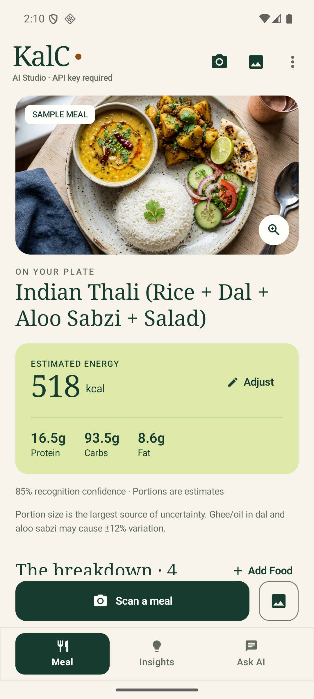
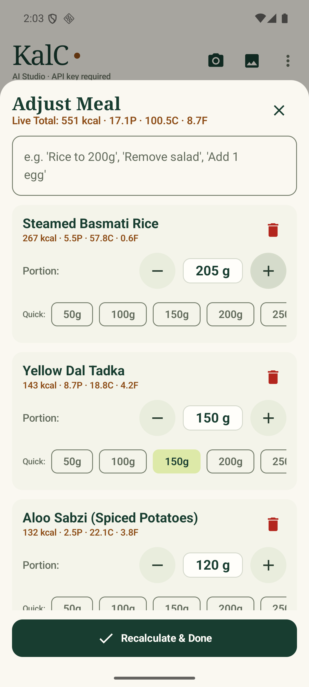
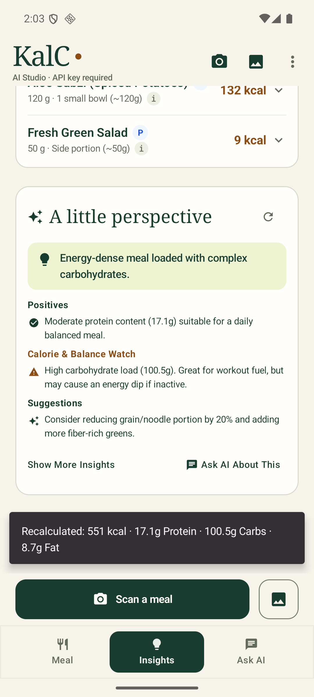
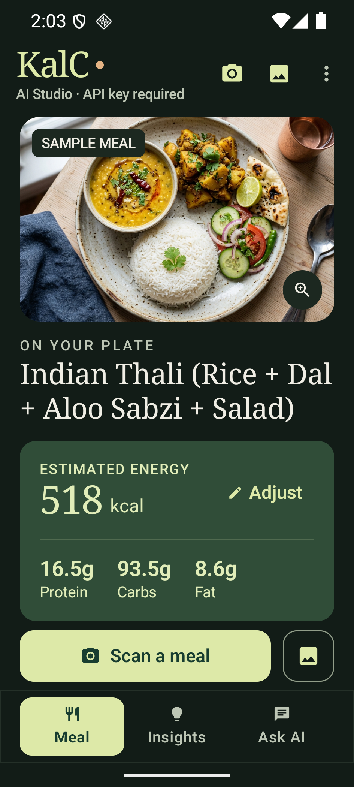

# KalC 1.2 — native visual refresh

Version 1.1 included the Vertex migration and a separate HTML design proposal. It did not include the native redesign. **Version 1.2 implements the new appearance in the installed app.**

## What changed

- Forest green, warm ivory, and citrus highlights; a matching dark palette follows the system theme. Wallpaper colors no longer override the brand.
- Serif KalC wordmark and meal headings, a larger edge-to-edge meal photograph, and an explicit sample-meal label.
- A single, calm nutrition panel with estimated energy, readable macros, and direct portion adjustment. Confidence and uncertainty remain visible.
- A persistent Scan a meal button and gallery shortcut, with separate Meal / Insights / Ask AI navigation.
- Food breakdown rows, editing controls, insights, chat, and connection forms use the new colors and typography. Macro values and provider choices can wrap.
- Explicit light/dark system-bar appearance keeps Android's status/navigation icons readable.

No new image/font downloads or UI dependencies were added. Gemini remains 3.8 Flash on both providers, with the existing passkey, API-key support, and food validation gates.

## Install

Open `KalC-v1.2.apk` on the phone and tap Update/Install. It uses the **same private release certificate as v1.1** and a higher version code (3), so uninstalling v1.1 is unnecessary and saved settings are retained. Android may ask to allow installation from the source opening the APK. No USB debugging is required.

Owner APK: Windows `Downloads/KalC-v1.2.apk`. Reproducible build output: `app/build/outputs/apk/release/app-release.apk`. Signing instructions remain in `server/README.md`.

## Verification

- All 16 Android unit tests pass, including food rejection and exclusive Gemini 3.8 Flash routing.
- All three instrumentation tests pass on API 36: app context, live provider/passkey access, and the new native redesign workflow.
- The visual workflow checks the KalC wordmark, sample label, Scan action, changing a portion with a changed calorie total, insights navigation, chat input, and connection controls. It also passes at 360dp width, 130% text, and dark mode.
- Signed release assembly and release vital lint pass. The release certificate is unchanged from 1.1.
- Verified a real 1.1 → 1.2 release upgrade with `adb install -r`, without uninstalling: AI Studio selection and the dismissed-startup preference survived. The installed release showed the new KalC screen, cold-started in 922 ms on the emulator, and logged no AndroidRuntime crash. USB debugging was used by the automated test harness only; ordinary APK installation does not require it.
- Final release SHA-256: `e69bbb73d3e11f3445f1049217ec3f1b1663afa5c9507f4ae31a4ec5a63c3ad6`.
- Verified certificate SHA-256: `8cc8a357ddfe4a6e0f596b020bdf0b118e7dd4d6032997bb181f15fff90a3e14`, matching 1.1. APK Signature Scheme v2 verifies successfully; the release is non-debuggable and not test-only.

Native screenshots (the running Android app):

| Meal | Portion editing |
|---|---|
|  |  |

| Insights | Dark theme at 360dp / 130% text |
|---|---|
|  |  |

Physical-device camera capture, TalkBack, and screenshot rendering across every Android vendor are outside this emulator verification. The backend was not redeployed for the visual refresh; its previously verified model/passkey configuration remains in effect.
